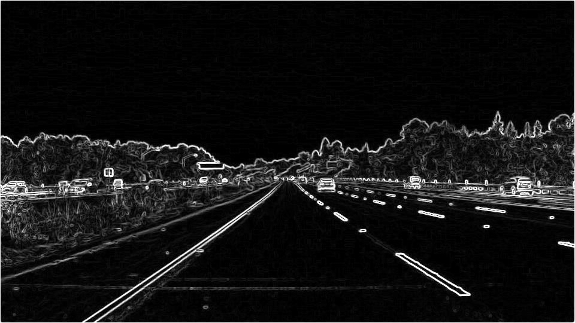
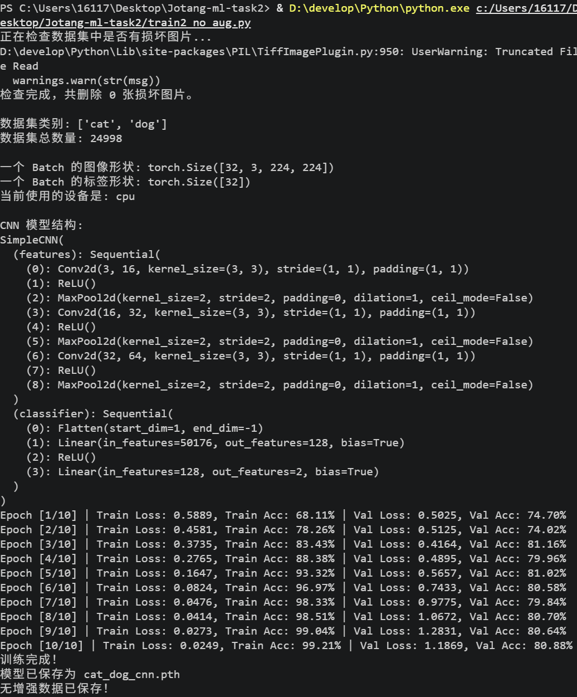
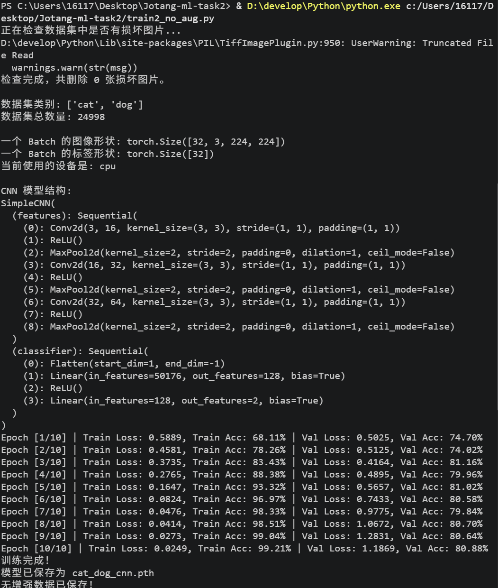
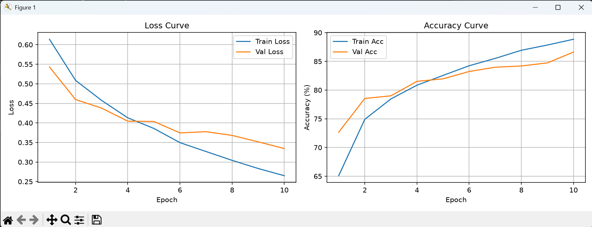
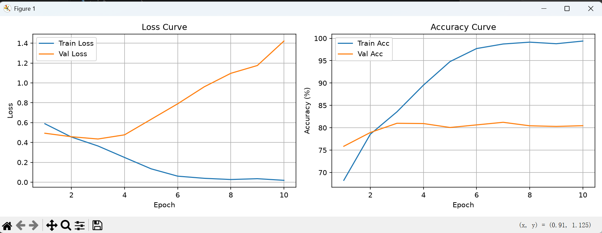
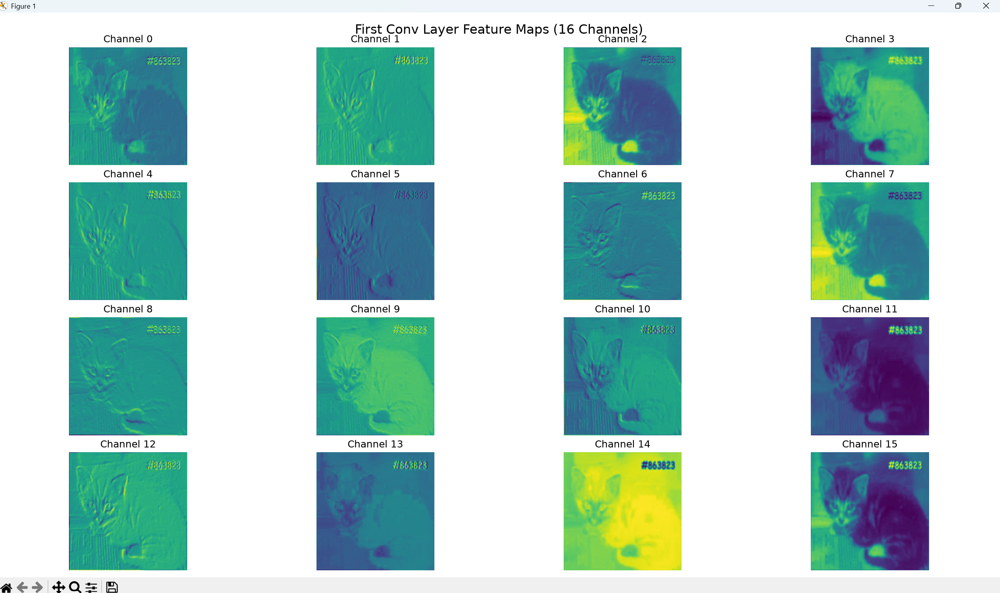
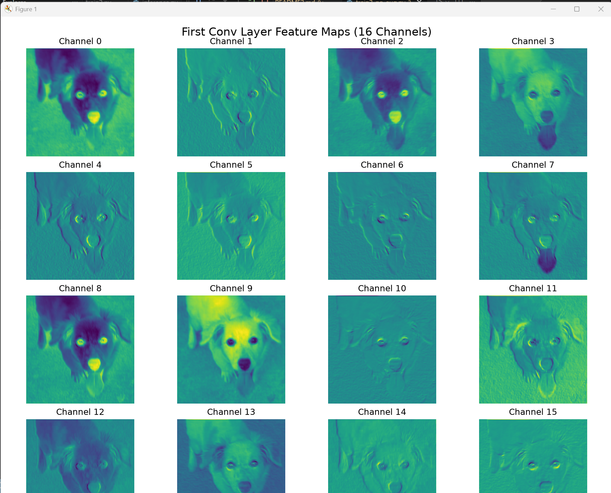
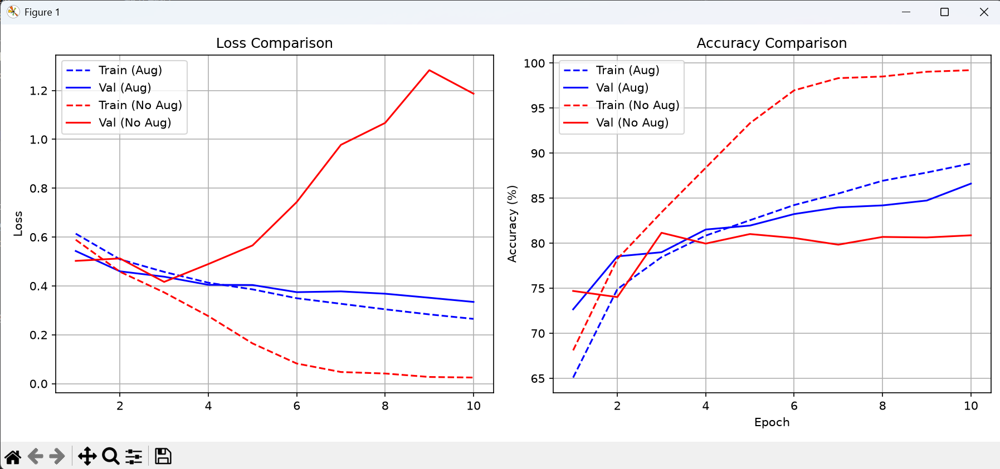

# Jotang-ml-task2
## 实践 1：卷积核
### 1. 图像表示
1. 像素 计算机里的图像,本质上是一个数字矩阵,像素是数字图像的最小组成单位，是图像里不可再分的一个小方块,每个像素记录一个“颜色值”或“亮度值",像素按行列排成网格构成一张图,像素越多,分辨率越高(低),图像越细腻(马赛克般颗粒感),灰度图一个像素只存1个数值(亮度),彩色图存3给(红,绿,蓝三个通道)
1. RGB RGB是彩色图像最常用的一种颜色表示方式,用红(R),绿(G),蓝(B)三种基色混合出各种颜色;每个通道的取值通常为0~255(8位,256级),1通道=8bit(8个二进制存一个颜色的亮度),三个通道不同强度的组合,可以表示约256×256×256≈1677万种颜色,即一张彩色图在计算机中其实是三个数字矩阵叠加 eg.(255, 0, 0)红色 (0,0,0)黑色 (255,255,255)白色 (255,255,0)红+绿=黄
2. 灰度图和彩色图灰度图一个像素只存1个数值(亮度),彩色图一个像素存3个(红,绿,蓝三个通道)
### 2. 读取图片和格式转换
**我的代码及解释理解**
`import numpy as np`
`from PIL import Image` 图像处理库
`import torch`
`import matplotlib.pyplot as plt` 画图工具

1.读取图片
`img_pil = Image.open('highway.jpg')`

2.转换为NumPy数组,变成三维数学矩阵方便数学计算 HWC格式(高,宽,通道数)
如一张800x600的彩色图，形状就是(800,600,3) 3代表红绿蓝三个通道
`img_np = np.array(img_pil)`

3.NumPy数组转换为 PyTorch Tensor (CHW 格式)
torch.from_numpy得到的还是HWC，需要permute换轴,换为CHW(通道,高,宽)
是PyTorch的硬性规定 卷积层要求输入的通道数在最前面
`img_tensor = torch.from_numpy(img_np).permute(2, 0, 1)`

4.打印信息 
`print("=== NumPy 数组信息 (HWC) ===")`
`print(f"Shape: {img_np.shape}")` 输出 (高, 宽, 3)
`print(f"Dtype: {img_np.dtype}")` 数据类型 通常照片是uint8(无符号8位整数),即数字范围在0到255间
print(f"Max: {img_np.max()}, Min: {img_np.min()}") 打印整张图里最大和最小的像素值

`print("\n=== PyTorch Tensor 信息 (CHW) ===")`
`print(f"Shape: {img_tensor.shape}")` 输出(3,高,宽)
`print(f"Dtype: {img_tensor.dtype}")` 保留原本的数据类型
但在真正送入神经网络前,我们还会把它转成float32并做归一化(按比例缩放到统一范围)消除量纲(物理量大小和单位有关)、提高模型训练稳定性并加速收敛

5.打印一个像素的RGB值(取左上角第一个像素) 即0行0列
`pixel_rgb = img_np[0, 0, :]`
print(f"\n左上角第一个像素的 RGB 值: {pixel_rgb}")

### 3. 二维卷积的基本过程
1. 卷积核是什么 卷积核是一个小矩阵(一次只看图片的一小块局部区域),里面是一组数字(权重,越大-重要性或影响程度越大),用来在图片上寻找某种特定特征(如边缘、模糊、锐化等)基于不同的数字/权重组合，对图像局部变化的敏感程度不同,深度学习中，这些数字是训练出来的,不是人手工设定的
2. 移动 卷积核像一个小窗口,在整张图上从左到右，一行扫完，再换下一行，继续从左到右，直到扫完整张图(类比读书),每行能移动几个位置就输出几个值,步长=每次移动几格(越大越快输出图小)
3. 每到一个位置做的计算 逐元素相乘再求和
把卷积核里的每个数字，和它正下方图片对应位置的像素值一一相乘把所有这些乘积加起来得到的总和，就是输出图该位置的一个数值,然后卷积核再滑到下一个位置,重复

### 4.手写二维卷积函数
**我的代码及解释理解**
`def my_conv2d(image, kernel, padding=0, stride=1):`
定义函数的关键字;函数名;image:输入参数,代表一张二维图像,是NumPy矩阵
kernel:输入参数,代表卷积核(提取输入数据的局部特征),一个小一点的二维矩阵
padding=0:vaild 四周补上0圈像素(默认),边缘直接参与计算,卷积核在边缘会“悬空”一部分(卷积核只能放在能完整盖住图片的位置,输出图比输入图小)
stride=1:步长 卷积核每次滑动几格

1 获取矩阵的尺寸
    `H, W = image.shape` 返回图像的高和宽负值给H和W
    `kH, kW = kernel.shape` 返回卷积核的高和宽赋值给KH和KW

2 处理图像边缘Padding(填充)
如果是valid(padding=0),则不填充；如果是same,则要计算
    `if padding > 0:`
        在图像四周填充0
        `padded_image = np.pad(image, ((padding, padding), (padding, padding)), mode='constant', constant_values=0)`
        np.pad:NumPy的填充函数;括号中表示在高度和宽度方向各填padding列;mode='constant':填充方式是“用常数填充" constant_values=0 常数的值是0(即黑边)
        why黑边:灰度图中0表示最暗即黑色 彩色图0也是最暗,即(0,0,0)为黑色,所以补0为黑边
    `else:`
        `padded_image = image` 直接用原图

更新填充后的尺寸
    `pH, pW = padded_image.shape`
    获取填充后图像的新高度pH和宽度pW,没填充就不变(H,W)

3 计算输出特征图尺寸
    公式::(输入尺寸+2*Padding-卷积核尺寸)/步长+1
    `out_H = (pH - kH) // stride + 1`
    `out_W = (pW - kW) // stride + 1`

4 初始化输出矩阵
    `output = np.zeros((out_H, out_W))`
    先建一个全为0的矩阵,大小是刚才算出来的out_H和out_W

5 开始滑动窗口(核心循环)
    `for i in range(out_H):` i是行索引
        `for j in range(out_W):` j是列索引
    两个循环遍历了输出矩阵的每个位置

找到当前窗口在原图上的起始和结束位置
            `h_start = i*stride` 第i个输出位置对应原图的行起始位置是i*stride
            `h_end = h_start+kH` 结束位置是起始位置加上卷积核的高度
            `w_start = j*stride `第j个输出位置对应原图的列起始位置是ji*stride
            `w_end = w_start+kW` 结束位置是起始位置加上卷积核的宽度

截取当前窗口区域
            `region = padded_image[h_start:h_end, w_start:w_end]`
            利用NumPy的切片功能,将原图上h_start-h_end,w_start-w_end这个矩形区域扣出,存在region变量里,region的尺寸和卷积核一样

对应位置相乘再求和 (点积)
            `output[i, j] = np.sum(region * kernel)`
            卷积的数学本质:抠出来的图像区域和卷积核对应位置相乘(不是矩阵乘法,是元素级相乘)
            np.sum(...):将相乘得到的所有数字加起来,将算出的这个总和填入输出矩阵(i,j)的位置
            完成一次卷积运算,循环继续
    `return output`

### 5.四种卷积核处理照片,原图和结果比较
把彩色图转为灰度图方便处理(手写函数目前只支持单通道,卷积核通常是一个二维矩阵)
`gray_img = np.array(img_pil.convert('L'))`
my_conv2d函数只能处理二维矩阵,彩色图片img_pil，用.convert('L')转成灰度图(L为亮度),用np.array()转成NumPy矩阵

1.均值模糊(取周围3*3区域所有像素的平均值,抹平细节)
`mean_kernel = np.ones((3, 3)) / 9.0`
生成一个3x3的全1矩阵,除以9让矩阵元素和为1
`blur_mean = my_conv2d(gray_img, mean_kernel, padding=1)`
padding=1 保证输出尺寸和原图一样

2.高斯模糊(中心像素更高的权重，给边缘像素更低的权重,模糊出来图片更自然)
计算好的5x5高斯核 (sigma=1.0) 用NumPy自动生成
`def get_gaussian_kernel(size=5, sigma=1.0):`
    `ax = np.arange(-size // 2 + 1., size // 2 + 1.)`  -生成坐标轴
    `xx, yy = np.meshgrid(ax, ax)`  -生成网络坐标
    `kernel = np.exp(-(xx**2 + yy**2) / (2. * sigma**2))`  -套用二维高斯公式
    `return kernel / np.sum(kernel)`  归一化
`gaussian_kernel = get_gaussian_kernel(size=5, sigma=1.0)`
`print(gaussian_kernel)`
`gaussian_kernel = np.array([`
    `[1, 4, 6, 4, 1],`
    `[4, 16, 24, 16, 4],`
    `[6, 24, 36, 24, 6],`
    `[4, 16, 24, 16, 4],`
    `[1, 4, 6, 4, 1]`
`]) / 256.0 ` 保证权重之和为1,不会让图片整体变亮或变暗(权重归一化)
`blur_gaussian = my_conv2d(gray_img, gaussian_kernel, padding=2)` 
padding=2 保证尺寸不变

锐化(放大差异)
`sharpen_kernel = np.array([`
    `[0, -1, 0],`
    `[-1, 5, -1],`
    `[0, -1, 0]`
`])`

### 6.解释每种处理带来的变化
**1. 为什么均值与高斯卷积会让图片变模糊？**
   **均值**:均值卷积核(3*3)把每个像素替换成邻域的平均值,使相邻像素差异变小,细节丢失,视觉上就是模糊.相当于把每个像素与周围像素"混合",抹平了图像中变化剧烈的部分(高频细节，如边缘、纹理)
   **高斯卷积**:高斯卷积核(5*5)也是做加权平均,但是给中心像素更高的权重,给边缘像素更低的权重,这样模糊出来的效果更自然,无明显的方块感
**2. 为什么锐化会让边缘更明显？**
   **锐化卷积核**`[[0,-1,0], [-1,5,-1], [0,-1,0]]`特点:中心是正数(5)，周围是负数(-1),计算时,则计算5*中心像素-上-下-左-右
   中心像素比周围亮(边缘处),会变得更亮,如果比周围暗,会变得更暗,中心像素和周围像素差不多,结果约等于原值,变化小
   本质:锐化核放大中心像素与周围像素的差异,增强了对比度,所以边缘看起来更明显,锐利
**3.Sobel卷积核为什么能找到边缘？**
    **Sobel卷积核**:本质是计算图像的梯度(变化率)
    sobel_x:算水平方向像素差值(右-左),能检测垂直边缘(左右变化大的地方)(左负右正)
    sobel_y:算垂直方向像素差值(下-上),能检测出水平边缘(上下变化剧烈的地方)(上负下正)
    图像平坦区域,像素值变化小,梯度接近0,卷积结果接近黑色;图像的边缘处,像素值从黑变白(或白到黑)变化率最大,梯度值很大,卷积结果就是一条亮线
    最后平方和相加在开方得到最终边缘强度

### 7.，比较输出尺寸与边缘像素的变化
**测试Padding和Stride对输出尺寸的影响**
`import numpy as np`
`from PIL import Image`
最前面已经导入过
img_pil是读出来的图片Tensor，形状为(H,W,C)

1. 准备灰度图（前面的my_conv2d只接受二维矩阵）
`img_pil_gray = Image.open('highway.jpg').convert('L')`
重新读取并转为灰度，避免受前面彩色变量的干扰
`img_np_gray = np.array(img_pil_gray, dtype=np.float32)` 
把PIL的图片对象转换成NumPy数组(矩阵) 变成32位浮点数方便计算(原图是uint8 只能存0-255的整数)
`print(f"\n灰度图形状: {img_np_gray.shape}, 类型: {img_np_gray.dtype}")`

1. 定义一个简单的均值卷积核(3*3)
`test_kernel = np.ones((3, 3)) / 9.0`

1. 运行Valid模式(不填充)
`out_valid = my_conv2d(img_np_gray, test_kernel, padding=0, stride=1)`
调用手写的卷积函数
`print(f"Valid 模式输出形状: {out_valid.shape}")`  
输出尺寸会变小 卷积核无法覆盖到最边缘的像素，所以丢失了边缘信息

1. 运行Same模式(填充)
`out_same = my_conv2d(img_np_gray, test_kernel, padding=1, stride=1)`
`print(f"Same 模式输出形状: {out_same.shape}")`  
输出尺寸和原图一样 因为补了边

1. 运行stride=2模式(卷积核每次滑动2格)
`out_stride2 = my_conv2d(img_np_gray, test_kernel, padding=1, stride=2)`
`print(f"Stride=2 输出形状: {out_stride2.shape}")` 
输出尺寸减半

**====图像卷积完成后，部分结果可能小于0或大于原来的像素范围:====**
截断:小于0的全部变成0,大于255的全部变成255-np.clip
`clipped = np.clip(edge_combined, 0, 255)` 
edge_combined 是算出来的包含负数的矩阵

类型转换:之前计算用的float32 照片格式只接受unit8,会直接砍掉小数部分
`final_img = clipped.astype(np.uint8)`

转回PIL对象(数组变回图片对象)
`pil_image = Image.fromarray(final_img)`

保存 
`pil_image.save('result.jpg')` 
`print("已保存: result.jpg")`

## 实践 2：训练猫狗分类器
### 1. 
`import os`                           导入Python自带的os(操作系统),用来处理文件路径
`import torch`                        PyTorch核心库
`import torch.nn as nn `              PyTorch的神经网络工具箱(包含卷积层、全连接层等)
`import torch.optim as optim`         PyTorch的优化器工具箱(如Adam,SGD更新神经网络的参数）
`from torch.utils.data import DataLoader, random_split` 
 从PyTorch的工具箱里，拿出DataLoader(把图片打包成Batch)和random_split(把数据集切成训练集和验证集)
`from torchvision import datasets, transforms`           
 把视觉工具库(torchvision)里的datasets(自动读取文件夹里的图片),transforms(对图片做预处理如缩放,旋转)拿出来
`import matplotlib.pyplot as plt`     导入画图工具(后面画Loss/Acc曲线)
`import numpy as np`                  矩阵计算库

### 2,数据预处理
`train_transform = transforms.Compose([`
 定义一个"训练集流水线",用compose把步骤串起来
        `transforms.Resize((224, 224)),`
 神经网络要求输入尺寸必须一致,所以把所有图片的尺寸改成224像素宽,224像素高(原图尺寸不一)
            `transforms.RandomHorizontalFlip(),`
 随机水平翻转(50%) 使数据增强(比如猫朝左,翻转后朝右,模型能学到"不管朝哪都是猫")
                `transforms.RandomRotation(10),`
 随即旋转,角度再-10和10之间 使数据增强(模拟拍摄时相机倾斜情况)
                    `transforms.ColorJitter(brightness=0.2, contrast=0.2),`
 随机调整亮度和对比度,幅度是2.0 数据增强(模拟不同光照条件下的照片)
                        `transforms.ToTensor(),`
 图片转换为PyThon里面的Tensor(张量)图片形状HWC-CWH 像素值0-255变成0.0-1.0的浮点数
                            `transforms.Normalize(mean=[0.485, 0.456, 0.406],` `std=[0.229, 0.224, 0.225])`
 标准化:对每个通道,减去均值,再除以标准差;让数据分布更接近标准正态分布,加速模型训练收敛;这组数字是ImageNet数据集(大规模标注图像数据库)统计出来的“黄金标准值”
`])`
`val_transform = transforms.Compose([`
    `transforms.Resize((224, 224)),  `统一尺寸
    `transforms.ToTensor(),`  转为张量
    `transforms.Normalize(mean=[0.485, 0.456, 0.406], std=[0.229, 0.224, 0.225]) ` 标准化(和训练集一致)
`])`
 定义验证集流水线;验证集不能做数据增强(翻转,旋转,调颜色),只做必要的预处理(Resize,ToTensor,Normalize)
 验证集做客观评价,不可改变原图

===========加载数据集 划分==============
`data_dir = './data/train'`
 当前目录下-data 文件夹-train 文件夹
 ======= 自动检测并删除损坏图片 =======
`import os`
`from PIL import Image`

`data_dir = './data/train'`
`p`rint("正在检查数据集中是否有损坏图片...")`
`bad_count = 0`
`for root, dirs, files in os.walk(data_dir):`
    `for file in files:`
       ` if file.lower().endswith(('.png', '.jpg', '.jpeg', '.bmp', '.gif')):`
            `file_path = os.path.join(root, file)`
            `try:`
                `with Image.open(file_path) as img:`
                   `img.verify() `
           ` except Exception as e:`
                `print(f"发现坏图，已删除: {file_path}")`
                `os.remove(file_path)`
                `bad_count += 1`
`print(f"检查完成，共删除 {bad_count} 张损坏图片。\n")`

 然后再加载数据集
 图片所在路径是当前目录下的data/train文件夹
`full_dataset = datasets.ImageFolder(root=data_dir)`
 用ImageFolder扫描此文件夹,自动识别子文件夹(cat和dog),每个类别分配一个数字标签,并把所有图片路径和标签存起来
`print(f"数据集类别: {full_dataset.classes}")`
`print(f"数据集总数量: {len(full_dataset)}")`

 打印类别列表和总数
`train_size = int(0.8 * len(full_dataset))`
 训练集大小=总数据*80% int取整,防止出现小数张照片
`val_size = len(full_dataset) - train_size`
 验证集大小=总数-训练集大小(即20%)
`train_dataset, val_dataset = random_split(full_dataset, [train_size, val_size])`
 把full_dataset随机切分成两份,长度是train_size和val_size
`train_dataset.dataset.transform = train_transform`
 把train_transform流水线绑定到训练集上,random_split切分后的子集默认没有transform属性
 必须有这行数据增强才生效
`train_loader = DataLoader(train_dataset, batch_size=32, shuffle=True)`
 创建一个训练集数据加载器 每次打包32张图一起送进模型,每个Epoch打乱顺序
`val_loader = DataLoader(val_dataset, batch_size=32, shuffle=False)`
 创建验证集数据加载器,验证集不需要打乱
`images, labels = next(iter(train_loader))`
 检查数据格式是否正确:iter(train_loader)把加载器变成迭代器(遍历容器元素),next()从中取出第一个Batch的数据
`print(f"\n一个 Batch 的图像形状: {images.shape}")`
`print(f"一个 Batch 的标签形状: {labels.shape}")`
 打印形状(应该是(32,3,224,224)即32张图,3通道,224*224)标签为32

### 3 4 5. CNN模型
`class SimpleCNN(nn.Module):`
 定义一个类SimpleCNN,继承自nn.Module,PyTorch规矩:所有神经网络必须继承nn.Module
        `def __init__(self):`
            `super(SimpleCNN, self).__init__()`
 构造函数(初始化) super()._init_()是固定写法,先初始化父类
            `self.features = nn.Sequential(`
 定义一个叫features(特征提取器)的容器,用Sequential把后面的层按顺序串起来
                `nn.Conv2d(3, 16, kernel_size=3, padding=1),`  
 卷积层为1,输入通道=3,输出通道=16,卷积核大小3*3,Padding=1
                `nn.ReLU(),`                  
 激活函数ReLU,将负数变为0,正数不变  引入非线性,让网络能拟合复杂函数                  
                `nn.MaxPool2d(kernel_size=2, stride=2),`        
 池化层1(缩减特征图尺寸,提取核心特征并提高计算效率) 用2x2的窗口,步长2,取最大值  使宽高减半,保留最显著的特征
                `nn.Conv2d(16, 32, kernel_size=3, padding=1),`
                `nn.ReLU(),`
                `nn.MaxPool2d(kernel_size=2, stride=2),  `
 卷积层2 + ReLU + 池化层 2      16-32 通道,尺寸 112-56   
                `nn.Conv2d(32, 64, kernel_size=3, padding=1), `
                `nn.ReLU(),`
                `nn.MaxPool2d(kernel_size=2, stride=2),`   
 卷积层3 + ReLU + 池化层 3      32-64 通道,尺寸 56-28
        )
            `self.classifier = nn.Sequential(`
            `nn.Flatten(),`
 定义分类器(classifier)容器,nn.Flatten()：把(64,28,28)的特征图“拍扁”成64*28*28=50176 的一维向量
            `nn.Linear(64 * 28 * 28, 128),`
 全连接层1 输入50176维,输出128维
            `nn.ReLU(),`
 激活函数ReLU
            `nn.Linear(128, 2)`
 全连接层2 输入128维,输出2维(对应猫和狗两个类别)
        `)`
        `def forward(self, x):`   前向传播函数 x是输入图片
            `x = self.features(x) `  x先经过特征提取器(3个卷积块)
            `x = self.classifier(x) ` x再经过分类器(全连接层)
            `return x`         返回最终输出(2个数值,猫和狗的分数)
 1. 定义设备（有显卡用显卡，没显卡用 CPU）
`device = torch.device("cuda" if torch.cuda.is_available() else "cpu")`
 1. 实例化模型，并把它搬到 device 上
`model = SimpleCNN().to(device)`
 1. 打印一下当前用的是什么设备（方便确认）
`print(f"当前使用的设备是: {device}")`
`print("\nCNN 模型结构:")`
`print(model) `  打印模型结构,检查每一层是否正确
`criterion = nn.CrossEntropyLoss() `  定义损失函数为交叉熵损失,衡量模型输出与真实标签的差距
`optimizer = optim.Adam(model.parameters(), lr=0.001)`   定义优化器Adam，学习率lr=0.001 根据损失,自动调整模型里的所有参数 

==============训练循环===============
`num_epochs = 10`   训练10轮
`train_losses, val_losses = [], []`  用来装每轮的 Loss，方便后面画图
`train_accs, val_accs = [], []`  用来装每轮的 Accuracy

`for epoch in range(num_epochs): ` 大循环
    `model.train()`                       到训练模式,启用Dropout,BatchNorm等训练时才用的层
    `running_loss = 0.0`                累加这一轮损失
    `correct_train = 0 `                记录预测对了多少张
    `total_train = 0`                   记录一共看了多少张

`for images, labels in train_loader:`  train_loader每次吐出32张图和对应的标签,直到训练集所有图片都过一遍
`images, labels = images.to(device), labels.to(device)`
把数据搬到 GPU/CPU 上，保证模型和数据在同一块设备上
        
`optimizer.zero_grad()`         清空旧梯度   
`outputs = model(images)`          前向传播
`loss = criterion(outputs, labels)`   计算损失
`loss.backward()`     反向传播             
`optimizer.step()`      更新参数           
        
`running_loss += loss.item()`  这一批的损失值(张量变成普通数字)加到总损失里
`_, predicted = torch.max(outputs.data, 1)`  outputs是32行2列的数据,每一行里找最大值,返回最大值和最大值所在的索引
`total_train += labels.size(0)` 
`correct_train += (predicted == labels).sum().item()`
labels.size(0)是这一批的样本数(32) (predicted == labels) 逐个对比预测和真实标签，相等返回1,不相等返回0，.sum()加起来是这一批预测正确的数量
    `train_loss = running_loss / len(train_loader)`
    `train_acc = 100 * correct_train / total_train`
    `train_losses.append(train_loss)`
    `train_accs.append(train_acc)`
     循环结束，总损失除以批次数得平均损失,正确数除以总数得准确率 存进账本

`model.eval()`进入评估模式                 
    `running_val_loss = 0.0` 上下文管理器(不用计算梯度,验证阶段不用更新参数，省显存和计算时间)
    `correct_val = 0`
    `total_val = 0`

`with torch.no_grad():`       上下文管理器,验证时不计算梯度，节省显存
    `for images, labels in val_loader:`
        `images, labels = images.to(device), labels.to(device)`
        `outputs = model(images)`
        `loss = criterion(outputs, labels)`

`running_val_loss += loss.item()`
`_, predicted = torch.max(outputs.data, 1)`
`total_val += labels.size(0)`
`correct_val += (predicted == labels).sum().item()` 和训练阶段几乎一样,只是少三步(不算梯度)

`val_loss = running_val_loss / len(val_loader)`
`val_acc = 100 * correct_val / total_val`
`val_losses.append(val_loss)`
`val_accs.append(val_acc)`  计算验证集的平均损失和准确率，存进“账本”

打印本轮结果
`print(f"Epoch [{epoch+1}/{num_epochs}] | "`
`f"Train Loss: {train_loss:.4f}, Train Acc: {train_acc:.2f}% | "`
`f"Val Loss: {val_loss:.4f}, Val Acc: {val_acc:.2f}%")`

`print("训练完成！")`

 =============保存模型==============
`torch.save(model.state_dict(), 'cat_dog_cnn.pth')`
 model.state_dict() 是模型学到的所有参数(权重和偏置),torch.save 存成一个文件
`print("模型已保存为 cat_dog_cnn.pth")`

### 6. 特征图可视化

`model.eval()` # 切换到评估模式
`with torch.no_grad():` 关闭梯度计算
        `sample_images, sample_labels = next(iter(train_loader))`
        train_loader里随机拿一个Batch的数据,DataLoader变成迭代器,迭代器里取出一组数据(32张图+32个标签)
        `sample_images:[32, 3, 224, 224] sample_labels:[32]`
        `sample_img = sample_images[0:1].to(device)`
        32张里取第一张搬到GPU上,[0:1]保留batch维度(模型要求),张量搬到和模型相同的设备
        `first_conv_output = model.features[0](sample_img)`
        model.features:特征提取容器[0]:第一层卷积,图片给这层卷积,得输出first_conv_output形状
`fig, axes = plt.subplots(4, 4, figsize=(12, 12))`
        创建画布:4行4列,fig:画布,axes:16个格子组成数组,axes.flat可把他拉成一维,方便循环
`fig.suptitle('First Conv Layer Feature Maps (16 Channels)', fontsize=16)`
        给画布加一个大标题
`for i, ax in enumerate(axes.flat):` 
        遍历16个格子,拉平成16个元素的数组,enumerate同时获取索引i(0-15)和格子对象ax
    `feature_map = first_conv_output[0, i].cpu().numpy()`
    取出第i个通道的特征图,张量从GPU搬到CPU(matplotlib只画),PyTorch张量转成numpy数组(matplotlib画)
    `ax.imshow(feature_map, cmap='viridis')`
    前格子里画这张特征图,cmap='viridis':颜色映射 深紫色=低激活(弱响应),亮黄=高激活(强)'gray':黑白图
    `ax.set_title(f'Channel {i}')`
    每个子图加标题标明是第几个通道
    `ax.axis('off')`
    关掉子图的坐标轴
`plt.tight_layout()`
调整间距,使美观
`plt.show()`
显示画布

### 数据增强对照实验
**train2_no_aug.py中无有数据增强对照试验**
即将数据增强部分注释
结果:无增强时,训练集(train)Loss降得快,训练集Acc会升高;验证集(val)Loss先降后升,验证集Acc停滞甚至下降,即过拟合
有增强时:训练集Loss降得慢,验证集Loss下降,验证集Acc上升,说明增强让模型泛化能力更强(训练数据中学到的规律迁移到未知数据的能力强)
**见train2_no_aug.py**

### Loss和accurancy曲线
============绘制曲线===============
`plt.figure(figsize=(12, 4))`
准备画布 宽12(英寸) 高4(英寸)
1. Loss 曲线
`plt.subplot(1, 2, 1)` # 把画布切成格子:1行2列(两个格子),现在再第一个(左边的)格子画Loss曲线
`plt.plot(range(1, num_epochs+1), train_losses, label='Train Loss')`
画折线图 range(1, num_epochs+1):横坐标(x),代表第一轮到第十轮(num_epochs=10),train_losses:纵坐标(Y),装训练集每轮Loss值,这条线起名为“Train Loss”
`plt.plot(range(1, num_epochs+1), val_losses, label='Val Loss')`
同上一行,画的是验证集的Loss曲线
`plt.xlabel('Epoch')` #给x轴贴标签:Epoch(轮次)
`plt.ylabel('Loss')` # 给y轴贴标签:Loss(损失值)
`plt.title('Loss Curve')` # 这张图起大标题:Loss曲线
`plt.legend()` # 显示图例:把label起的名字(Train Loss和Val Loss)显示在角落,显示哪条是哪条
`plt.grid(True)` # 打开网格线,画格子方便看数值

2. Accuracy 曲线
`plt.subplot(1, 2, 2)` #依旧是1行2列,但切换到第二个格子
`plt.plot(range(1, num_epochs+1), train_accs, label='Train Acc')`
`plt.plot(range(1, num_epochs+1), val_accs, label='Val Acc')`
`plt.xlabel('Epoch')`
`plt.ylabel('Accuracy (%)')`
`plt.title('Accuracy Curve')`
`plt.legend()`
`plt.grid(True)` 
同上面代码一样逻辑,横坐标依旧为Epoch(轮次),纵坐标切换为准确率Accuracy
画了两条线:训练集准确率(train_acc)和验证集准确率(val_acc),最后加上坐标轴名字,标题,图例,网格

`plt.tight_layout()` # 自动调整间距,排版更美观
`plt.show()` # 画图

### 推理程序
**inference.py独立推理文件**
`import torch`
`import torch.nn as nn`
`from torchvision import transforms`
`from PIL import Image`
`import matplotlib.pyplot as plt`

==========================================
1. 定义模型结构（和训练时一样,见train2.py）
`class SimpleCNN(nn.Module):`
    `def __init__(self):`
        `super(SimpleCNN, self).__init__()`
        `self.features = nn.Sequential(`
            `nn.Conv2d(3, 16, kernel_size=3, padding=1), nn.ReLU(), nn.MaxPool2d(2, 2),`
            `nn.Conv2d(16, 32, kernel_size=3, padding=1), nn.ReLU(), nn.MaxPool2d(2, 2),`
            `nn.Conv2d(32, 64, kernel_size=3, padding=1), nn.ReLU(), nn.MaxPool2d(2, 2),`
        `)`
        `self.classifier = nn.Sequential(`
            `nn.Flatten(),`
            `nn.Linear(64 * 28 * 28, 128), nn.ReLU(),`
            `nn.Linear(128, 2)`
        `)`
    `def forward(self, x):`
        `x = self.features(x)`
        `x = self.classifier(x)`
        `return x`

==========================================
2. 加载模型
`device = torch.device("cuda" if torch.cuda.is_available() else "cpu")`
检查有无显卡,没有就用CPU
`model = SimpleCNN().to(device)`
实例化刚才定义的模型,搬到对应设备上
`model.load_state_dict(torch.load('cat_dog_cnn.pth', map_location=device))`
torch.load('cat_dog_cnn.pth'):从硬盘上把之前训练保存的"学习成果"(参数文件)读出来
map_location=device 确保如果模型是在GPU上训练,现在在CPU上也能加载(反之亦然)
model.load_state_dict(...) 把参数灌入空壳模型中

`model.eval()`   切换到评估模式
`print(f"模型加载完成，使用设备: {device}")`

==========================================
3. 图片预处理(和验证集一致)

`preprocess = transforms.Compose([`
    `transforms.Resize((224, 224)),`
    `transforms.ToTensor(),`
    `transforms.Normalize(mean=[0.485, 0.456, 0.406], std=[0.229, 0.224, 0.225])`
`])`

==========================================
4. 读取本地图片并推理
`img_path = r'C:\Users\16117\Desktop\Jotang-ml-task2\data\train\cat\8.jpg'`  要预测的图片路径
`image = Image.open(img_path).convert('RGB')`  强制转成RGB三通道(模型只认)

`input_tensor = preprocess(image).unsqueeze(0).to(device)`
图片变成形状[3, 224, 224]的张量(通道,高,宽),增加一个维度:模型要求输入[batch_size, 3, 224, 224],变成[1, 3, 224, 224]
张量搬到和模型相同的设备

开始推理（不用计算梯度）
`with torch.no_grad():` 告诉不计算梯度
    `output = model(input_tensor)`
    图片给模型,得输出 output形状是[1, 2]
    `probabilities = torch.nn.functional.softmax(output, dim=1)`
    Softmax:把原始分数变成概率,加起来等于1,dim=1:在类别这个维度做Softmax
    `prob_cat = probabilities[0][0].item()`
    `prob_dog = probabilities[0][1].item()`
    probabilities[0]：取第一个(唯一个)样本概率
    [0],[1]:分别取猫,狗的概率 .item():把PyTorch张量变成普通Python浮点数,方便打印
    `_, predicted = torch.max(output, 1)` 在[1, 2]的输出里找最大值,返回最大值和所在索引
    `class_names = ['cat', 'dog']` 定义类别名,索引0对应 cat，索引1对应dog,顺序和训练时ImageFolder扫描顺序一致
`print(f"\n预测结果: {class_names[predicted.item()]}")`
`print(f"猫的概率: {prob_cat:.4f}")`
`print(f"狗的概率: {prob_dog:.4f}")`
打印最后结果

显示图片和预测结果
`plt.imshow(image)` 画原图
`plt.title(f"Pred: {class_names[predicted.item()]} (Cat: {prob_cat:.2f}, Dog: {prob_dog:.2f})")` 图片上方写预测结果和概率
`plt.axis('off')` 关坐标轴(图片不需要)
`plt.show()` 显示

## 趁热打铁
### 1. 
卷积优势：参数效率:利用局部连接和权值共享,极大减少了参数量,且保留了图片的二维空间结构;参数量爆炸(把224x224x3的图拉平成150528维,参数量达30万),容易过拟合且难训练,准确率低;空间结构:全连接层会把图片拉平成一维向量丢,失了像素间的二维空间位置关系,卷积层保留空间结构,能提取边缘,纹理等局部特征;平移不变性:卷积层能识别出图片中不同位置的同一个物体,全连接层难做到

### 2.
输入通道:输入数据的深度(卷积核深度),eg.第一层是RGB图片则输入通道是3,中间层是上一层输出的特征图数量
输出通道:本层提取的特征种类数(有多少种特征图)
关系:输出通道数=卷积核的数量 N个卷积核扫描输入(分别提取一种特定的特征),生成N张特征图,即N个输出通道
### 3.
Padding:增大输出尺寸,保持边缘信息,Stride:卷积核移动步长,减小输出尺寸;Pooling:对局部区域下采样(减少数据的空间分辨率或数量来压缩信息,提取高级特征),显著减小输出尺寸
输出尺寸=(输入尺寸(Input)-卷积核尺寸(k)+2 padding)/Stride+1
### 4.
宽高变小:浓缩信息,降低空间分辨率(描述影像能呈现的空间细节程度),减少计算量,同时扩大感受野(看到更大的图像区域)
通道变多:增加特征丰富度,浅层特征(边缘,颜色(16通道))比较单一,深层需要组合这些特征形成复杂语义(眼睛,猫脸),因此需要更多"滤波器"来捕捉这些复杂模式
### 5.
激活函数：ReLU 计算简单,能有效缓解梯度消失,加速深层网络训练
损失函数：CrossEntropyLoss二元交叉熵,配合Softmax将输出转为概率分布,二分类任务的输出通常是0到1间的概率(猫和狗),BCE能很好衡量预测概率和真实标签(0或1)间的差异,且梯度性质优良,适合优化
### 6.
原因：验证/测试集用于模拟真实世界,评估模型在真实,未修改数据上的表现,真实场景不会随机翻转或裁剪.若对它们做随机增强,评估结果会有随机性,无法真实反映模型性能.
翻转:帮助模型适应左右不分(不同朝向),增加数据多样性
裁剪:帮助模型关注局部,适应物体在画面中位置的变化,以及部分遮挡的情况,增强对平移的鲁棒性(抗干扰能力)
颜色变化:适应不同光照条件,色差,防止模型过度依赖颜色特征

## 拓展
### 1.了解AlexNet,VGG和ResNet
AlexNet:层数8,卷积核11,5,3(大卷积核引入);首次使用ReLU,Dropout(抑制过拟合)
VGG:层数16/19;卷积核全是3*3(小);证明深度比大卷积核更重要,但是全连接层导致参数量巨大
ResNet:引入残差连接,解决深层网络梯度消失问题,能训练到152层
网络越深,特征越抽象,但太深会梯度消失；ResNet用残差连接让152层也能训练
### 2. ResNet
`import torch`
`import torchvision.models as models` 导入模型库,加载预训练权重
`import matplotlib.pyplot as plt`

1. 加载预训练 ResNet-18
`model = models.resnet18(pretrained=True)` 创建一个模型并下载预训练权重,pretrained=True:用别人训好的参数
`model.eval()`切到推理模式

2. 用 hook 提取中间层输出(闭包写法)
`features = {}`建一个空字典,存中间层的输出(抓到的特征图)

`def get_hook(name):`
    `def hook(module, input, output):` PyTorch 的 hook 固定接收三个参数——当前层本身、输入、输出,只要 output
        `features[name] = output.detach()` 输出从计算图里剥离出来，不再带梯度
    `return hook`

第一层卷积：conv1（浅层）
`model.conv1.register_forward_hook(get_hook('shallow'))`注册前向 hook,每次数据前向经过这一层，就自动调用 hook 函数，把输出抓下来
最后一层卷积：layer4 中最后一个 block 的 conv2（深层）
`model.layer4[-1].conv2.register_forward_hook(get_hook('deep'))`

3. 前向传播
`dummy = torch.randn(1, 3, 224, 224)`造一张随机假图当输入
`with torch.no_grad():`关闭梯度计算,只提取特征，不反向传播
    `model(dummy)`假图喂给模型，触发前向传播

1. 对每个通道沿 h,w 计算 L2 范数---形状从 (b,c,h,w) 变为 (b,c)
`def channel_l2(feat):`
    `return torch.norm(feat, p=2, dim=(2, 3))` 形状变成 b * c,每个通道一个强度值

`shallow_l2 = channel_l2(features['shallow'])`  conv1 的输出(1, 64)
`deep_l2   = channel_l2(features['deep']) `     ayer4 最后卷积的输出(1, 512)

1. 可视化对比
`fig, axes = plt.subplots(1, 2, figsize=(12, 4))`

`axes[0].bar(range(64), shallow_l2[0].numpy())`画柱状图 取 batch 里第 0 个样本，得到长度 64 的向量
`axes[0].set_title('Shallow (conv1): 64 channels')`
`axes[0].set_xlabel('Channel index')`
`axes[0].set_ylabel('L2 norm')`画深层 512 个通道的柱状图

`axes[1].bar(range(512), deep_l2[0].numpy())`
`axes[1].set_title('Deep (layer4 last conv): 512 channels')`
`axes[1].set_xlabel('Channel index')`

`plt.tight_layout()`
`plt.show()`
### 3.了解 ResNet 中的 BasicBlock 与 Bottleneck
**BasicBlock**:两个3*3卷积，通道数全程不变;残差连接直接相加，要求输入输出形状一致;结构简单，适合浅层网络
**Bottleneck**:减少3*3卷积的计算量和参数量,先把通道压到1/4,再在低维上做3*3，最后升回去,适合通道数很大的深层网络

## 附:运行结果
推理结果

有增强版本日志

无增强版本日志

有数据增强的曲线

无数据增强的曲线

猫的特征图

狗的特征图

两种增强方式对比

